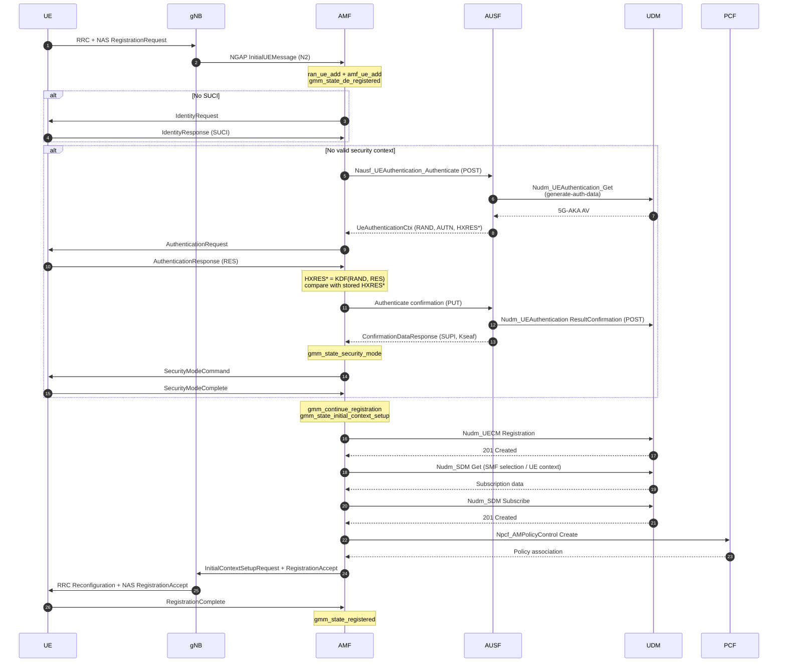
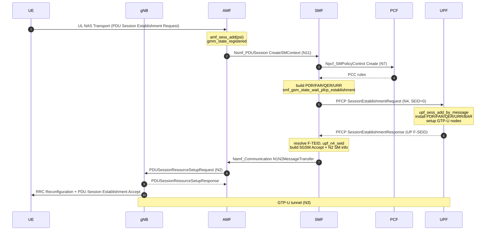

# Aether5GC Internals

**A code-level architecture walkthrough of the 5G core and EPC data paths.**

This document explains how the core actually works by following the code in this
tree. It is a reading guide, not a specification: every claim below is traceable
to a source file and symbol. Line numbers refer to this checkout (Open5GS 2.8.0
base) and will drift as the code changes; prefer the named functions.

If you only read one section, read [Trace A](#trace-a--5g-initial-registration)
and [Trace B](#trace-b--pdu-session-and-the-user-plane). They connect the
control plane, the service-based interface, and the user plane end to end.

---

## Contents

1. [Method and scope](#1-method-and-scope)
2. [Process and threading model](#2-process-and-threading-model)
3. [The event loop](#3-the-event-loop)
4. [The finite-state-machine framework](#4-the-finite-state-machine-framework)
5. [Anatomy of a network function](#5-anatomy-of-a-network-function)
6. [Context, identity, and lifetime](#6-context-identity-and-lifetime)
7. [Trace A — 5G initial registration](#7-trace-a--5g-initial-registration)
8. [The SBI transaction and NF discovery](#8-the-sbi-transaction-and-nf-discovery)
9. [Trace B — PDU session and the user plane](#9-trace-b--pdu-session-and-the-user-plane)
10. [Timers, retransmission, and failure handling](#10-timers-retransmission-and-failure-handling)
11. [Design observations](#11-design-observations)
12. [Where to change what](#12-where-to-change-what)
13. [Glossary](#13-glossary)

---

## 1. Method and scope

This analysis was produced by reading the control-plane and user-plane sources
in this repository, starting from the executable entry point and following
events, state transitions, and protocol messages. No behavior is inferred from
the 3GPP specifications alone; where the code and the specification differ, the
code is described.

The interesting question for a maintainer is not "which NF implements which
interface" (the README covers that) but:

- How does a packet or a NAS message become a state transition?
- How does an NF find another NF without hard-coded addresses?
- How does a control-plane decision become a forwarding rule in the UPF?
- Where does state live, and who frees it?

Those four questions organize the rest of the document.

---

## 2. Process and threading model

Each network function is a **separate operating-system process** built from the
shared libraries in `lib/`. There is no supervisor process and no shared memory
between NFs; they communicate only over 3GPP interfaces (SBI/HTTP-2, NGAP/SCTP,
PFCP/UDP, GTP-U/UDP, Diameter, …).

A process has two threads of consequence:

| Thread | Created by | Responsibility |
| --- | --- | --- |
| Main thread | `main()` | Signal handling and orderly shutdown |
| Worker thread | `<nf>_initialize()` via `ogs_thread_create()` | Configuration, event loop, all protocol state machines |

`src/main.c` parses the command line, initializes the shared application
context (`ogs_app_initialize()`), calls the NF-specific `app_initialize()`, and
then blocks in `ogs_signal_thread()`. The NF's `app_initialize()` — for example
`src/amf/app.c:23` — initializes SCTP support and calls `amf_initialize()`.
That function builds the context and starts exactly one worker:

```c
/* src/amf/init.c */
thread = ogs_thread_create(amf_main, NULL);   /* line 74 */
```

Every NF follows the same shape: `pcf/init.c`, `smf/init.c`, `upf/init.c`,
`nrf/init.c`, and so on each create one `*_main` thread. The worker owns the
event loop for the lifetime of the process.

Two consequences matter when debugging:

1. **State machines are single-threaded.** No lock protects `amf_ue_t`,
   `smf_sess_t`, or `upf_sess_t`, because only the worker thread mutates them.
   The cost is that one slow handler blocks every UE in that NF; the benefit is
   deterministic ordering and no data races.
2. **Cross-thread wakeups go through the event queue.** `ogs_queue_term()` plus
   `ogs_pollset_notify()` is how the main thread asks the worker to stop
   (`src/amf/init.c:86-89`). Protocol code never touches another thread's
   structures directly.

Shutdown is deliberately ordered. `amf_terminate()` stops the queue, notifies
the pollset, joins the worker, and only then closes SBI and frees the context.
The worker itself stops accepting N2 events, closes NGAP listeners, drains SBI
transactions, and finalizes the top-level FSM (`src/amf/init.c:142-153`).

---

## 3. The event loop

The loop is small enough to quote. This is `amf_main()` from
`src/amf/init.c:101-141`; `smf_main()`, `upf_main()`, and the rest are
structurally identical.

```c
ogs_fsm_init(&amf_sm, amf_state_initial, amf_state_final, 0);

for ( ;; ) {
    ogs_pollset_poll(ogs_app()->pollset,
            ogs_timer_mgr_next(ogs_app()->timer_mgr));

    ogs_timer_mgr_expire(ogs_app()->timer_mgr);

    for ( ;; ) {
        amf_event_t *e = NULL;

        rv = ogs_queue_trypop(ogs_app()->queue, (void**)&e);
        ogs_assert(rv != OGS_ERROR);

        if (rv == OGS_DONE)
            goto done;
        if (rv == OGS_RETRY)
            break;

        ogs_assert(e);
        ogs_fsm_dispatch(&amf_sm, e);
        ogs_event_free(e);
    }
}
```

The three objects are created once per process in
`lib/app/ogs-init.c:160-165` (Stage 8):

```c
ogs_app()->queue     = ogs_queue_create(ogs_app()->pool.event);
ogs_app()->timer_mgr = ogs_timer_mgr_create(ogs_app()->pool.timer);
ogs_app()->pollset   = ogs_pollset_create(ogs_app()->pool.socket);
```

### Why the order is fixed

`ogs_pollset_poll()` blocks until a socket is readable/writable, a timer is due,
or the pollset is notified. It is passed the *next* timer deadline so it does not
sleep past a timer. After it returns, `ogs_timer_mgr_expire()` must run before
the queue is drained: a timer callback may stop another timer, which changes the
value `ogs_timer_mgr_next()` would return. The comment at
`src/amf/init.c:112-122` records this ordering constraint explicitly.

Only then are queued events dispatched, one at a time, until the queue is empty
(`OGS_RETRY`) or the process is told to terminate (`OGS_DONE`).

### The event object

All NFs share a base event, `ogs_event_t`, defined in `lib/proto/event.h`. It
carries an `id`, a `timer_id`, and the SBI payload (`sbi.response`,
`sbi.data`, …). NF-specific event types embed it as their first member — for
example `amf_event_t.h` — and add their own payloads (`ngap`, `nas`, pool IDs,
`pfcp_message`). `ogs_event_size(id, size)` allocates the correct struct for the
event ID. IDs are defined in `src/<nf>/event.h` and start at
`OGS_MAX_NUM_OF_PROTO_EVENT`, so protocol events
(`OGS_EVENT_SBI_SERVER`, `OGS_EVENT_SBI_CLIENT`) and NF events
(`AMF_EVENT_5GMM_MESSAGE`, `AMF_EVENT_5GMM_TIMER`, …) share one namespace.

Two rules keep the model coherent:

- **Producers enqueue, consumers dispatch.** A socket callback, a timer, or an
  SBI server callback creates an event and pushes it; it does not call the FSM
  directly. This serializes all state transitions onto the worker thread.
- **The event owns transient buffers.** `ogs_fsm_dispatch()` consumes the event,
  then `ogs_event_free()` releases it. Handlers that need to keep a buffer copy
  it or take a reference.

---

## 4. The finite-state-machine framework

The FSM implementation is ~150 lines (`lib/core/ogs-fsm.c`) and is used by every
NF, every UE/session context, and every SBI NF instance.

### The four primitives

```c
void ogs_fsm_init(void *fsm, void *init, void *fini, void *event);
void ogs_fsm_tran(void *fsm, void *state, void *event);
void ogs_fsm_dispatch(void *fsm, void *event);
void ogs_fsm_fini(void *fsm, void *event);
```

A state is just a function pointer with the signature
`void (*)(void *sm, void *event)`. `ogs_fsm_t` stores three of them: `init`,
`fini`, and the current `state` (`lib/core/ogs-fsm.h:43-47`).

### Transition semantics (the subtle part)

`OGS_FSM_TRAN` does **not** run entry/exit handlers. It only assigns the target
state:

```c
/* lib/core/ogs-fsm.h:54-55 */
#define OGS_FSM_TRAN(__s, __target) \
    ((ogs_fsm_t *)__s)->state = (ogs_fsm_handler_t)(__target)
```

The transition is completed by `ogs_fsm_dispatch()` after the current state
handler returns (`lib/core/ogs-fsm.c:115-131`):

```c
tmp = sm->state;          /* state before the handler ran */
(*tmp)(sm, e);            /* run the current state handler */

if (sm->state != tmp)     /* handler called OGS_FSM_TRAN */
    fsm_change(fsm, tmp, sm->state, e);   /* exit old, enter new */
```

`fsm_change()` calls the old state with `OGS_FSM_EXIT_SIG`, then the new state
with `OGS_FSM_ENTRY_SIG` (`lib/core/ogs-fsm.c:63-75`). Because the same event
object is reused, entry/exit handlers see the triggering event's payload with
`e->id` overwritten to `OGS_FSM_ENTRY_SIG` or `OGS_FSM_EXIT_SIG`
(`lib/core/ogs-fsm.c:37-61`). This is why state handlers almost always begin
with:

```c
switch (e->h.id) {
case OGS_FSM_ENTRY_SIG:  /* allocate, start timer, arm counters */
    break;
case OGS_FSM_EXIT_SIG:   /* stop timer, release scratch state */
    break;
case AMF_EVENT_5GMM_MESSAGE:
    ...
}
```

Two practical consequences:

- A handler may transition **at most once** per event; a second
  `OGS_FSM_TRAN` before returning silently overwrites the first.
- Side effects in `OGS_FSM_ENTRY_SIG` run *after* the handler that requested the
  transition has returned, not at the call site. Code that expects the new
  state's initialization to have happened immediately is wrong.

`ogs_fsm_init()` is slightly different: it calls the init handler and, if the
init handler transitioned, runs the new state's entry action immediately
(`lib/core/ogs-fsm.c:77-95`). This is how a context boots straight into
`gmm_state_de_registered` (`src/amf/gmm-sm.c:67-74`).

### Nesting

FSMs nest. The AMF has:

- one top-level FSM per process (`amf_sm`, states `amf_state_initial` →
  `amf_state_operational` → `amf_state_final`);
- one FSM per gNB (`amf_gnb_t.sm`, NGAP association lifecycle);
- one FSM per UE (`amf_ue_t.sm`, the 5GMM states);
- one FSM per SBI NF instance (`ogs_sbi_nf_instance_t.sm`, NF registration and
  heartbeats).

Events are routed by the top-level FSM to the correct child. For NAS, the
top-level `amf_state_operational` decodes the NGAP message, finds or creates the
UE context, sets `e->amf_ue_id`, and calls
`ogs_fsm_dispatch(&amf_ue->sm, e)` (`src/amf/amf-sm.c:1187-1193`). The child
never sees raw NGAP.

---

## 5. Anatomy of a network function

Every NF directory under `src/` follows the same decomposition. Using the AMF as
the reference:

| File | Role |
| --- | --- |
| `app.c` | `app_initialize()` / `app_terminate()` glue for `src/main.c` |
| `init.c` | Config parsing, SBI/NGAP setup, worker thread, event loop |
| `context.c/.h` | Global NF state, pools, hash tables, config-derived identity |
| `event.c/.h` | NF-specific event IDs and event constructors |
| `amf-sm.c` | Top-level FSM: routes SBI and NGAP events |
| `gmm-sm.c` | Per-UE 5GMM state machine |
| `gmm-handler.c` | Stateless-ish NAS message handling called from the FSM |
| `gmm-build.c` | NAS message construction |
| `nas-path.c` | NAS → NGAP send helpers |
| `ngap-path.c`, `ngap-handler.c`, `ngap-build.c` | N2 transport, decode, encode |
| `sbi-path.c` | SBI client/server setup and per-UE request helpers |
| `n<api>-build.c` | Build an SBI request body for one service |
| `n<api>-handler.c` | Consume an SBI response for one service |
| `timer.c/.h` | NF-specific timer configuration and names |
| `metrics.c` | Prometheus collectors |

The naming convention is the map. `nausf-handler.c` handles responses from the
AUSF (`Nausf_UEAuthentication`); `nudm-handler.c` handles UDM; `npcf-handler.c`
handles PCF; `nsmf-handler.c` handles SMF. The same pattern appears in the SMF
(`npcf`, `nudm`, `namf`, `nsmf`) and the UPF (mostly N4/PFCP, no SBI).

### The `*-build` / `*-handler` split

A request is always built by a pure-ish function and sent through a generic
path. For example, the AMF's per-UE send helper takes the builder as a function
pointer:

```c
/* src/amf/sbi-path.c:97 */
int amf_ue_sbi_discover_and_send(
        OpenAPI_service_name_e service_name,
        ogs_sbi_discovery_option_t *discovery_option,
        ogs_sbi_request_t *(*build)(amf_ue_t *amf_ue, void *data),
        amf_ue_t *amf_ue, int state, void *data);
```

This is the central abstraction of the control plane: **discover the target NF,
build the request, send it, and remember which UE and which FSM state the
response belongs to.** The response later arrives as `OGS_EVENT_SBI_CLIENT` and
is routed back to the same UE FSM.

### The state machine is the protocol

There is no separate "procedure" object. The current state *is* the procedure
position. `gmm_state_authentication` means "we have sent Authentication Request
and are waiting for Authentication Response or an AUSF confirmation"; the
handlers for those two events are cases in that one function. This makes the
control flow easy to follow but means a state function can be large
(`gmm_state_registered` spans hundreds of lines because it handles mobility,
service requests, PDU sessions, and deregistration while registered).

---

## 6. Context, identity, and lifetime

The AMF keeps three linked context types. Understanding their relationship is
the key to reading any 5G NF.

```
amf_gnb_t  ──1:N──▶  ran_ue_t  ──1:1──▶  amf_ue_t  ──1:N──▶  amf_sess_t
(NGAP peer)          (N2 context)        (NAS/5GMM)          (PDU session)
```

### `ran_ue_t` — the N2 context

Created when a gNB sends an Initial UE Message, keyed by the pair
`(gNB, RAN UE NGAP ID)`. It owns the NGAP stream association, the UE's
aggregate maximum bit rate, and the "initial context setup already sent" flag
(`ran_ue->initial_context_setup_request_sent`). It is destroyed when the NG
connection is released. `ran_ue_add()` is at `src/amf/context.c:1448`.

### `amf_ue_t` — the NAS/5GMM context

The durable identity: SUPI/SUCI, 5G-GUTI, security context, registration state,
allowed NSSAI, subscribed slice/session data, and the `sm` FSM. It survives NG
connection release and is found on the next attach by 5G-S-TMSI. `amf_ue_add()`
is at `src/amf/context.c:1716`.

### `amf_sess_t` — the PDU session context

One per PDU session ID (PSI). It stores the S-NSSAI, DNN, the SMF's N11
association, and the N2 SM information needed for NGAP. `amf_sess_add()` is at
`src/amf/context.c:2626`.

### Storage: fixed pools plus hash indexes

Contexts are **not** allocated with `malloc` per UE. Each type has a static
`OGS_POOL`, sized from configuration at startup:

```c
/* src/amf/context.c:62-67 */
ogs_pool_init(&amf_gnb_pool, ogs_global_conf()->max.peer*2);
ogs_pool_init(&amf_ue_pool,  ogs_global_conf()->max.ue);
ogs_pool_init(&ran_ue_pool,  ogs_global_conf()->max.ue);
ogs_pool_init(&amf_sess_pool, ogs_app()->pool.sess);
ogs_pool_init(&m_tmsi_pool,  ogs_global_conf()->max.ue*2);
```

A pool allocates a stable index, and every context carries an `id` derived from
that index. This is why events can carry `amf_ue_id`, `sess_id`, or
`ran_ue_id` as small integers and why `amf_ue_find_by_id()` is O(1) and cannot
dangle: the pool slot is not reused until the object is freed.

Lookup by protocol identity uses hash tables created in `amf_context_init()`
(`src/amf/context.c:76-85`):

| Hash | Key | Used for |
| --- | --- | --- |
| `gnb_addr_hash` | peer address | Find the gNB for an inbound NGAP packet |
| `gnb_id_hash` | Global RAN Node ID | Resolve the gNB for handover/NG setup |
| `guti_ue_hash` | 5G-GUTI | Find an existing UE on mobility registration |
| `suci_hash` | SUCI | Find a UE before authentication |
| `supi_hash` | SUPI | Find a UE after authentication |

The dual `suci_hash` / `supi_hash` is a direct consequence of the registration
flow: before authentication the AMF may only know the SUCI; after authentication
it learns the SUPI and re-indexes the same context.

### Memory ownership

Three allocators coexist:

- **`ogs_pool_*`** for long-lived contexts (`amf_ue_t`, `smf_sess_t`, …). Fixed
  capacity, index-based, freed on explicit remove.
- **`ogs_calloc` / `ogs_malloc`** for transient messages and request/response
  bodies. Freed by the owning path.
- **`talloc`** for packet buffers and the UPF's GTP forwarding pool
  (`lib/core/ogs-pkbuf.c`, `src/upf/gtp-path.c:980-982`). The root context is
  `__ogs_talloc_core`; `SIGUSR1`/`SIGUSR2` print its size and full report
  (`src/main.c:63-75`), which is the first thing to check for a leak.

---

## 7. Trace A — 5G initial registration

This trace follows a UE from the first NGAP message to the `REGISTERED` state.
It touches NGAP, NAS, four SBI services (AUSF, UDM, PCF, and optionally
5G-EIR), and the timer manager.

### 7.1 Entry: NGAP to NAS

A gNB sends an NGAP `InitialUEMessage` carrying a NAS `RegistrationRequest`.
`amf_state_operational` handles the NGAP event, decodes the NAS message,
finds or creates `ran_ue_t` and `amf_ue_t`, and dispatches the NAS event to the
UE FSM (`src/amf/amf-sm.c:1187-1193`). A fresh UE context starts in
`gmm_state_de_registered`.

### 7.2 `gmm_state_de_registered`

`src/amf/gmm-sm.c:83`. On `AMF_EVENT_5GMM_MESSAGE` it calls the shared
`common_register_state(..., GMM_COMMON_STATE_DEREGISTERED)` at line 165. That
function (`src/amf/gmm-sm.c:1663`) is the real registration dispatcher and is
reused from `REGISTERED` for mobility and periodic updates.

The decision tree after `gmm_handle_registration_request()`
(`src/amf/gmm-handler.c:58`) succeeds:

```
Registration Request
├─ from old AMF?  ──yes──▶ Namf_Communication UEContextTransfer to old AMF
├─ no SUCI?      ──yes──▶ Identity Request (T3570), wait for Identity Response
├─ integrity protected AND security context valid?
│   ├─ yes ──▶ Registration Update path (mobility / periodic)
│   │           ├─ UDM SDM not subscribed ──▶ Nudm_UECM Register + initial context setup
│   │           ├─ PCF policy not associated ─▶ Npcf_AMPolicyControl Create + initial context setup
│   │           └─ else ──▶ Registration Accept
│   └─ no  ──▶ Nausf_UEAuthentication Authenticate + gmm_state_authentication
```

The code for this branch is `src/amf/gmm-sm.c:1788-1874`. Two details are easy
to miss:

- The "old AMF" branch (`gmm_registration_request_from_old_amf()`) runs before
  the SUCI check and sends `Namf_Communication_UEContextTransfer`, because the
  new AMF needs the old AMF's security context and subscription data.
- The decision to skip authentication is `h.integrity_protected &&
  SECURITY_CONTEXT_IS_VALID(amf_ue)` (line 1796), not merely "we have a GUTI".
  An unprotected request always triggers authentication.

### 7.3 Authentication: AUSF and 5G-AKA

The AMF sends `Nausf_UEAuthentication_Authenticate` through the generic SBI
path (`amf_nausf_auth_build_authenticate`). The response is handled in
`gmm_state_authentication` (`src/amf/gmm-sm.c:2126`) by
`amf_nausf_auth_handle_authenticate()` (`src/amf/nausf-handler.c:23`).

That handler extracts the `AV5G_AKA` from `UeAuthenticationCtx`, derives RAND
and AUTN, stores the expected `HXRES*`, and sends the NAS Authentication
Request (`src/amf/nausf-handler.c:23-181`). When the UE returns
Authentication Response, `gmm_handle_authentication_response()`
(`src/amf/gmm-handler.c:981`) computes `HXRES*` from the UE's `RES` and compares
it with the stored value; on a match it stores `XRES*` and calls
`Nausf_UEAuthentication_Authenticate` again with `PUT` (confirmation). Only
after the AUSF confirms does the AMF transition to `gmm_state_security_mode`
(`src/amf/gmm-sm.c:2432`).

The split matters: the AMF does not need the long-term key. It verifies a
hash, and the AUSF/UDM own the credentials.

### 7.4 Security mode

`gmm_state_security_mode` (`src/amf/gmm-sm.c:2763`). On entry it sends
`SecurityModeCommand` with the selected NEA/NIA algorithms (line 2787). On
`SecurityModeComplete` it calls `gmm_handle_security_mode_complete()`
(`src/amf/gmm-handler.c:1105`), then either:

- continues registration via `gmm_continue_registration()`
  (`src/amf/gmm-sm.c:2647`), or
- runs a 5G-EIR equipment check first if configured, which is why the state
  also handles `AMF_EVENT_5GMM_EIR_FAILURE` (line 2802).

`gmm_continue_registration()` sends `Nudm_UECM_Registration` and transitions to
`gmm_state_initial_context_setup`. Note that it *does not* wait for the UDM
response before transitioning; the response is handled inside
`initial_context_setup`.

### 7.5 Initial context setup and subscription data

`gmm_state_initial_context_setup` (`src/amf/gmm-sm.c:3167`) is a small
orchestration FSM. The UECM registration response drives a chain of SBI calls:

```
Nudm_UECM Registration (PUT) response              [gmm-sm.c:3287]
  └─▶ Nudm_SDM GET ?dataset-names=AM,SMF_SEL        [amf_nudm_sdm_build_get_datasets]
        └─▶ ProvisionedDataSets split into AM_DATA + SMF_SELECT_DATA
              └─▶ Nudm_SDM GET (UE context in SMF data)
                    ├─ SDM already subscribed ──▶ Npcf_AMPolicyControl Create
                    └─ not subscribed ──▶ Nudm_SDM Subscribe (AM_DATA)
                                              └─▶ Npcf_AMPolicyControl Create
                                                    └─▶ Registration Accept
```

The combined `AM,SMF_SEL` GET is a local optimization: the AMF asks UDM for
both datasets in one round trip, then dispatches each half through the same
per-dataset handler. The subscription branch and the PCF call are in
`src/amf/nudm-handler.c:324-343` and `:345-446`.

The `Registration Accept` send helper also emits the NGAP
`InitialContextSetupRequest` on the first call
(`src/amf/nas-path.c:142-153`), so the NAS accept and the N2 setup travel
together. When the UE answers with `RegistrationComplete`, the FSM moves to
`gmm_state_registered`.

### 7.6 Sequence



### 7.7 Where the code can go wrong

The FSM's `gmm_state_exception` (`src/amf/gmm-sm.c:3757`) is the common sink
for protocol errors. It releases sessions, deregisters from the UDM, and
removes the UE context. A registration that "hangs" is usually a missing SBI
response, not a missing state transition: the FSM is waiting in
`initial_context_setup` for a response whose HTTP status was not 2xx and whose
error branch did not transition. Enable `debug` logging on the AMF and look for
the `service_name` in the ignored-response message.

---

## 8. The SBI transaction and NF discovery

Every control-plane NF must answer two questions before sending a request:
*which* NF instance, and *how do I correlate the response* with the UE/session
that triggered it. Both are solved by `ogs_sbi_xact_t` and
`ogs_sbi_discover_and_send()`.

### 8.1 The transaction object

`ogs_sbi_xact_t` (`lib/sbi/context.h:276-350`) is the correlation record. The
important fields:

| Field | Purpose |
| --- | --- |
| `service_name` | Target SBI service (e.g. `nudm_uecm`) |
| `requester_nf_type` | Who is asking (AMF, SMF, …) |
| `discovery_option` | S-NSSAI, DNN, TAI, target PLMN, GUAMI |
| `request` | Fully built HTTP request |
| `sbi_object` / `sbi_object_id` | Owning UE/session (so the response can find it) |
| `assoc_stream_id` | Inbound HTTP/2 stream that triggered this call, if any |
| `state` | NF-specific FSM state to restore on the response |
| `user_data` | NF-specific snapshot (e.g. AMF's RAN-UE ID) |
| `t_response` | Response timeout timer |

`assoc_stream_id` is what makes **server-initiated callbacks** work. If the SMF
receives an N11 request on an inbound stream and then calls the UDM, the
outbound transaction is linked to the inbound stream. When the UDM responds, the
SMF can reply on the original N11 stream. If the peer closes that stream early,
`lib/sbi` cancels every attached transaction, preventing timer-pool exhaustion
(the comment at `lib/sbi/context.h:290-322` documents this).

### 8.2 Discovery: cache, SCP, or NRF

`ogs_sbi_discover_and_send()` is at `lib/sbi/path.c:285`. Its logic, in order:

1. **Attach to the inbound stream**, if `assoc_stream_id` is set
   (`lib/sbi/path.c:344`).
2. **Check the per-object cache.** The UE/session keeps a
   `service_name_array`; if it already points at a live `nf_instance`, reuse it
   (`lib/sbi/path.c:376-389`).
3. **Check the global NF-instance table** with
   `ogs_sbi_nf_instance_find_by_discovery_param(target_nf_type,
   requester_nf_type, discovery_option)` (`lib/sbi/path.c:381`). This is how an
   AMF reuses an SMF discovered for the same S-NSSAI/DNN/TAI.
4. **Indirect communication (SCP/SEPP).** If an SCP client is configured
   (`client_delegated_config.nrf.disc`), send through it, adding either
   `3gpp-Sbi-Target-apiRoot` (when the target is known) or the
   `3gpp-Sbi-Discovery-*` headers (when it is not)
   (`lib/sbi/path.c:421-470`).
5. **Direct communication (NRF).** Otherwise call
   `ogs_sbi_discover_only()` (`lib/sbi/path.c:614`), which builds
   `Nnrf_NFDiscovery` with `ogs_nnrf_disc_build_discover()` and sends it to the
   configured NRF (`lib/sbi/path.c:652-661`).

The discovery response is not handled in `path.c`. It arrives as
`OGS_EVENT_SBI_CLIENT` at the NF's top-level FSM, which dispatches
`nnrf_disc` to the NF-specific `nnrf-handler.c`. That handler stores the
discovered `nf_instance` in the cache and **re-sends the original request**
(the "discover then send" retry). This two-phase design keeps `path.c` free of
per-NF policy.

### 8.3 Why an `nf_instance` is not a pointer

Older designs stored `ogs_sbi_nf_instance_t *` directly in the cache. That
dangles when an NF deregisters. The current code stores an **ID** and resolves
it with `ogs_sbi_nf_instance_find()` before use
(`lib/sbi/path.c:365-389`). A stale cache entry becomes a cache miss and
triggers rediscovery instead of a use-after-free.

### 8.4 The response path

When the HTTP/2 client completes, `ogs_sbi_client_handler()`
(`lib/sbi/path.c:91`) allocates an `OGS_EVENT_SBI_CLIENT`, attaches the parsed
response and the transaction ID, and pushes it onto the process queue. Discovery
responses take a slightly different callback (`client_discover_cb()`,
`lib/sbi/path.c:123`) so the discovered `nf_instance` can be cached before the
event is enqueued. The top-level FSM then:

1. validates the SBI API version (`src/amf/amf-sm.c:336-353`);
2. routes `nnrf_disc` responses to discovery handling;
3. for everything else, resolve the `ogs_sbi_xact_t` from the transaction ID,
   take its `sbi_object_id` (and any `user_data` snapshot), find the owning
   `amf_ue_t` or `amf_sess_t`, and dispatch the event to that context's FSM
   (`src/amf/amf-sm.c:424-464`). The `nsmf_pdusession` case additionally
   restores the session and routes to the session-specific handler
   (`src/amf/amf-sm.c:466-549`).

This is why `gmm_state_authentication`, `gmm_state_initial_context_setup`, and
`gmm_state_registered` all contain `case OGS_EVENT_SBI_CLIENT:` blocks with a
`service_name_id` switch: each state consumes only the responses it expects.

---

## 9. Trace B — PDU session and the user plane

This trace starts with a NAS PDU Session Establishment Request and ends with a
GTP-U tunnel installed in the UPF. It crosses AMF → SMF (N11), SMF → PCF (N7),
SMF → UPF (N4/PFCP), and SMF → AMF → gNB (N1/N2).

### 9.1 AMF: UL NAS transport to N11

The UE sends `UL NAS Transport` carrying a 5GSM `PDU Session Establishment
Request`. `gmm_handle_ul_nas_transport()` (`src/amf/gmm-handler.c:1201`)
validates the PSI, creates `amf_sess_t` with `amf_sess_add()` (line 1295), and
sends `Nsmf_PDUSession_CreateSMContext` via
`amf_sess_sbi_discover_and_send()` (line 1661). The AMF does not interpret the
5GSM payload; it forwards it.

### 9.2 SMF: the GSM FSM

The SMF receives the N11 request on its SBI server. `smf_state_operational`
dispatches `OGS_EVENT_SBI_SERVER` to the session FSM. In
`smf_gsm_state_initial` (`src/smf/gsm-sm.c:263`), the
`Nsmf_PDUSession` / `SM_CONTEXTS` case calls
`smf_nsmf_handle_create_sm_context()` and, for home-routed roaming in the
V-SMF, transitions to `smf_gsm_state_wait_pfcp_establishment` (line 408).

The SMF FSM states that matter:

| State | Line | Meaning |
| --- | --- | --- |
| `smf_gsm_state_initial` | 263 | New session, no policy/PFCP yet |
| `smf_gsm_state_wait_epc_auth_initial` | 512 | EPC path only |
| `smf_gsm_state_wait_5gc_sm_policy_association` | 714 | Waiting for PCF SM policy |
| `smf_gsm_state_wait_pfcp_establishment` | 906 | Waiting for N4 response |
| `smf_gsm_state_operational` | 1073 | Session active |
| `smf_gsm_state_wait_pfcp_deletion` | — | Teardown |
| `smf_gsm_state_5gc_n1_n2_reject` | — | Send a 5GSM reject |

For a non-roaming 5G session, the SMF first associates with the PCF
(`Npcf_SMPolicyControl_Create`). The PCF response handler
(`src/smf/npcf-handler.c:817`) is what calls
`smf_5gc_pfcp_send_session_establishment_request()`. The policy decision
becomes the PDR/FAR/QER/URR set.

### 9.3 SMF: building the PFCP session

`smf_5gc_pfcp_send_session_establishment_request()`
(`src/smf/pfcp-path.c:575`) creates a PFCP transaction, stores the local
CP F-SEID, sets the header type to `SESSION_ESTABLISHMENT_REQUEST`, and sends
with **SEID = 0** because the peer's SEID is not known yet (the comment at
lines 604-607 cites TS 29.244 §7.2.2.4.2).

The message body is built by
`smf_n4_build_session_establishment_request()` (`src/smf/n4-build.c:23`),
which walks the session's PFCP object lists:

```c
/* src/smf/n4-build.c:91-115 */
ogs_list_for_each(&sess->pfcp.far_list, far)
    ogs_pfcp_build_create_far(&req->create_far[i], i, far);
ogs_list_for_each(&sess->pfcp.urr_list, urr)
    ogs_pfcp_build_create_urr(&req->create_urr[i], i, urr);
ogs_list_for_each(&sess->pfcp.qer_list, qer)
    ogs_pfcp_build_create_qer(&req->create_qer[i], i, qer);
if (sess->pfcp.bar)
    ogs_pfcp_build_create_bar(&req->create_bar, sess->pfcp.bar);
```

Each list was populated from policy and session configuration earlier. The
builder also sets the PDN type and the User ID (IMSI/IMEI) IEs
(`src/smf/n4-build.c:117-128`).

### 9.4 UPF: installing the session

The UPF's PFCP FSM receives the request in
`upf_pfcp_state_associated` (`src/upf/pfcp-sm.c:284-307`). It calls
`upf_sess_add_by_message()` to find or create `upf_sess_t`, checks that the
CP F-SEID is not already owned by another PFCP node (lines 291-303), and calls
`upf_n4_handle_session_establishment_request()`
(`src/upf/n4-handler.c:84`).

That function installs the rules in a fixed order:

1. PDRs (`ogs_pfcp_handle_create_pdr`), tracking the created PDRs.
2. FARs, URRs, QERs, BAR.
3. **GTP-U node setup** for each FAR:
   `ogs_pfcp_setup_far_gtpu_node(far)` (`src/upf/n4-handler.c:178-187`).
4. UE IP address and framed routes on created PDRs (lines 218-243).
5. TEID hash entries for uplink/downlink lookup (lines 245-251).
6. URR timers (line 254).
7. Flush any buffered downlink packets (lines 256-261).
8. Send `SessionEstablishmentResponse` with the UP F-SEID and, if the UPF
   supports FTUP, the created PDRs (`src/upf/n4-handler.c:263-271`).

The response is built and sent by
`upf_pfcp_send_session_establishment_response()`
(`src/upf/pfcp-path.c:225`).

### 9.5 Back to the SMF: N4 response to N1/N2

The PFCP response arrives as `SMF_EVT_N4_MESSAGE` and is dispatched to
`smf_gsm_state_wait_pfcp_establishment` (`src/smf/gsm-sm.c:906`). For the 5GC
path it calls `smf_5gc_n4_handle_session_establishment_response()`
(`src/smf/n4-handler.c:145`), which:

- commits the PFCP transaction;
- reads `UP F-SEID` into `sess->upf_n4_seid`;
- resolves each created PDR's F-TEID into local uplink/downlink addresses and
  TEIDs (`sess->local_ul_teid`, `sess->local_dl_teid`);
- sets up the SMF-side GTP-U node for PDRs whose source interface is
  `CP_FUNCTION`.

Then `smf_gsm_state_wait_pfcp_establishment` builds the NAS
`PDU Session Establishment Accept` and the NGAP
`PDUSessionResourceSetupRequestTransfer`, and sends them to the AMF with
`smf_namf_comm_send_n1_n2_message_transfer()`
(`src/smf/gsm-sm.c:1017-1033`). Finally it transitions to
`smf_gsm_state_operational` (line 1037).

The AMF's `Namf_Communication_N1N2MessageTransfer` handler extracts the NAS and
N2 payloads and forwards them to the gNB. The gNB allocates the N3 tunnel and
replies with `PDUSessionResourceSetupResponse`; from that point the user plane
is a direct GTP-U path between the gNB and the UPF.

### 9.6 Sequence



### 9.7 The user plane after setup

The UPF is now a forwarding engine driven by PFCP-installed state, not by
per-packet control messages:

- **Uplink:** GTP-U packet arrives on N3 → TEID lookup
  (`ogs_pfcp_object_teid_hash`) → PDR match → FAR applies outer-header
  creation → forwarded on N6.
- **Downlink:** IP packet arrives on N6 → PDR match by UE address → FAR applies
  GTP-U encapsulation → sent to the gNB's N3 address/TEID.
- **Charging/volume:** URR counters are updated per QER/PDR and reported to the
  SMF via `SessionReportRequest` when a threshold is crossed.

The UPF's fast path is in `src/upf/gtp-path.c`; the control path above only
prepares the tables it walks.

---

## 10. Timers, retransmission, and failure handling

### 10.1 Timer ownership

Each NF configures its timers from YAML into `ogs_timer_cfg_t` tables
(`src/<nf>/timer.c`). The timer manager is process-global and driven by the
event loop. A timer expiry enqueues an NF-specific event such as
`AMF_EVENT_5GMM_TIMER` or `SMF_EVT_N4_TIMER`; the FSM handles it like any other
event. Timers are never callbacks that mutate state directly.

The AMF's NAS timers are visible in `gmm_state_de_registered`:

- `T3570` — Identity Request retransmission (line 170).
- `T3522` — Deregistration Request retransmission (line 185).
- `MOBILE_REACHABLE` — starts the implicit deregistration timer (line 201).
- `IMPLICIT_DEREGISTRATION` — network-initiated implicit deregistration
  (line 236).

Retransmission is explicit: increment `retry_count`, resend, and transition to
`gmm_state_exception` when `max_count` is exceeded. There is no hidden retry
layer.

### 10.2 Failure sinks

| Failure | Handling |
| --- | --- |
| SBI request cannot be built/sent | `amf_ue_sbi_discover_and_send()` sends a GMM reject with `504 Gateway Timeout` (`src/amf/sbi-path.c:137-157`) |
| SBI response non-2xx | State-specific error branch, usually `nas_5gs_send_gmm_reject_from_sbi()` |
| PFCP establishment rejected | SMF transitions to `smf_gsm_state_5gc_n1_n2_reject` (`src/smf/gsm-sm.c:996-998`) |
| PFCP response timeout | `SMF_TIMER_PFCP_NO_ESTABLISHMENT_RESPONSE` tears the session down (`src/smf/gsm-sm.c:1046`) |
| NG connection lost | RAN-UE context removed; AMF-UE context retained for the next attach |
| UE context restore after failed registration | `AMF_RESTORE_CONTEXT_ON_FAILURE` restores a memento (`src/amf/gmm-sm.c:39-52`) |

The memento mechanism is worth noting. When a registered UE performs a
mobility update that fails midway, the AMF can restore the pre-update security
context and subscription state instead of forcing a full re-registration. The
snapshot is taken in `common_register_state()` when entering from `REGISTERED`
(`src/amf/gmm-sm.c:1689-1692`).

---

## 11. Design observations

These are the choices a reviewer should understand before modifying the core.

### Strengths

- **Uniform NF skeleton.** Once you can read the AMF, you can read the SMF,
  AUSF, PCF, and NRF. The `*-build` / `*-handler` / `*-sm` split is consistent.
- **Deterministic concurrency.** One worker per NF removes an entire class of
  races. Contexts need no locks, and event ordering is reproducible.
- **Explicit protocol state.** The FSM state is the procedure position, so
  packet captures and logs line up with source lines.
- **Bounded memory.** Fixed pools make capacity planning explicit and turn
  exhaustion into a clean rejection instead of an OOM kill.
- **Service discovery is centralized.** `lib/sbi/path.c` handles cache, SCP,
  and NRF paths for every NF; per-NF code only supplies a discovery option and
  a builder.

### Trade-offs

- **Head-of-line blocking.** A slow SBI call or a blocking operation in one
  handler stalls every UE in that NF. The design assumes handlers are short and
  I/O is asynchronous.
- **Large state functions.** `gmm_state_registered` and
  `smf_gsm_state_operational` are long because they multiplex many procedures.
  Adding a procedure means adding cases, not composing a new object.
- **Manual correlation.** The `sbi_object_id` + `state` + `user_data` triplet
  is powerful but easy to get wrong. A missing snapshot (for example, a stale
  RAN-UE ID) produces a response routed to the wrong context. The comment at
  `src/amf/sbi-path.c:208-228` documents a real bug of this class.
- **Generated SBI models.** The `OpenAPI_*` types come from the OpenAPI
  generator in `lib/sbi/openapi`. They are verbose and allocate heavily; hot
  paths avoid them (PFCP and GTP use hand-written codecs).
- **Fixed pools require restart to resize.** Changing `max.ue` needs a process
  restart, not a live reconfiguration.

### What is deliberately not here

- No shared-memory state between NFs; redundancy is external (NRF, DNS, load
  balancers).
- No built-in message bus; SBI is point-to-point HTTP/2.
- No dynamic plugin loading; NFs are compiled in.

---

## 12. Where to change what

A practical map for common tasks.

| Task | Start here |
| --- | --- |
| Add or change a NAS procedure | `src/amf/gmm-sm.c` (state), `src/amf/gmm-handler.c` (parse), `src/amf/gmm-build.c` (encode) |
| Change registration/subscription logic | `common_register_state()` at `src/amf/gmm-sm.c:1663`, `src/amf/nudm-handler.c` |
| Change authentication | `src/amf/nausf-handler.c`, `src/amf/gmm-sm.c:2126` |
| Add an SBI client call from the AMF | `src/amf/n<api>-build.c`, `src/amf/sbi-path.c`, handle the response in the owning GMM state |
| Change NF discovery | `lib/sbi/path.c` (`ogs_sbi_discover_and_send`), `lib/sbi/nnrf-*.c`, NF `nnrf-handler.c` |
| Change PDU session setup | `src/smf/gsm-sm.c` (FSM), `src/smf/nsmf-handler.c` (N11), `src/smf/npcf-handler.c` (policy) |
| Change PFCP rules | `src/smf/n4-build.c` (build), `src/smf/n4-handler.c` (response), `src/upf/n4-handler.c` (install) |
| Change GTP-U forwarding | `src/upf/gtp-path.c`, `lib/pfcp/` object/PDR/FAR helpers |
| Change NGAP encoding | `lib/ngap/`, `src/amf/ngap-build.c`, `src/amf/ngap-handler.c` |
| Add a metric | `src/<nf>/metrics.c`, `lib/metrics/` |
| Change YAML config | `lib/app/ogs-context.c`, `src/<nf>/context.c` (`*_context_parse_config`) |
| Add a new NF | Copy the smallest existing NF, implement `app.c`, `init.c`, `context.c`, `event.c`, `*-sm.c`, and register it in `src/meson.build` |

### Debugging order

1. `debug` logging on the NF (`-e debug` or `logger.level: debug`).
2. Follow the event ID and the FSM state in the log; each state handler logs
   `amf_sm_debug(e)` / `smf_sm_debug(e)`.
3. Check the SBI transaction: was the request sent, did discovery succeed, what
   HTTP status came back?
4. Check the PFCP transaction: SEID, cause, and created PDRs.
5. Check the user plane with `tcpdump` on N3/N6 and the UPF's TEID hash.

---

## 13. Glossary

| Term | Meaning in this codebase |
| --- | --- |
| **NF** | Network Function; one daemon process (`open5gs-amfd`, `open5gs-smfd`, …) |
| **SBI** | Service-Based Interface; JSON over HTTP/2 between control-plane NFs |
| **xact** | Transaction; `ogs_sbi_xact_t` or `ogs_pfcp_xact_t`, the correlation record |
| **FSM** | Finite-state machine; `ogs_fsm_t` plus a state function |
| **ran_ue** | N2/NGAP context for one UE on one gNB |
| **amf_ue** | NAS/5GMM context; survives NG connection release |
| **amf_sess / smf_sess / upf_sess** | Per-PDU-session contexts in the AMF, SMF, and UPF |
| **SEID** | PFCP Session Endpoint Identifier; local and peer halves |
| **F-TEID** | Fully Qualified TEID (address + TEID) for GTP-U |
| **PDR / FAR / QER / URR / BAR** | PFCP rules: detect, forward, QoS enforce, usage report, buffer |
| **N1/N2/N3/N4/N6** | 5G reference points: NAS, NGAP, GTP-U (RAN), PFCP, data network |
| **SUCI / SUPI** | Encrypted subscription identifier / permanent identifier |
| **5G-GUTI** | Temporary identifier used to find an existing UE context |

---

## References in this tree

- Event and FSM primitives: `lib/core/ogs-fsm.{c,h}`, `lib/core/ogs-proto.h`
- Startup and event loop: `lib/app/ogs-init.c`, `src/main.c`, `src/<nf>/init.c`
- SBI transport and discovery: `lib/sbi/path.c`, `lib/sbi/client.c`,
  `lib/sbi/server.c`, `lib/sbi/nnrf-*.c`
- AMF control plane: `src/amf/amf-sm.c`, `src/amf/gmm-sm.c`,
  `src/amf/gmm-handler.c`, `src/amf/nausf-handler.c`, `src/amf/nudm-handler.c`
- SMF control plane: `src/smf/gsm-sm.c`, `src/smf/nsmf-handler.c`,
  `src/smf/npcf-handler.c`, `src/smf/pfcp-path.c`, `src/smf/n4-build.c`,
  `src/smf/n4-handler.c`
- UPF user plane: `src/upf/pfcp-sm.c`, `src/upf/n4-handler.c`,
  `src/upf/gtp-path.c`
- Protocol codecs: `lib/nas/`, `lib/ngap/`, `lib/pfcp/`, `lib/gtp/`

---

*Aether5GC is a rebranded distribution of Open5GS 2.8.0. This document
describes the upstream implementation; see [NOTICE](NOTICE) for attribution.*
