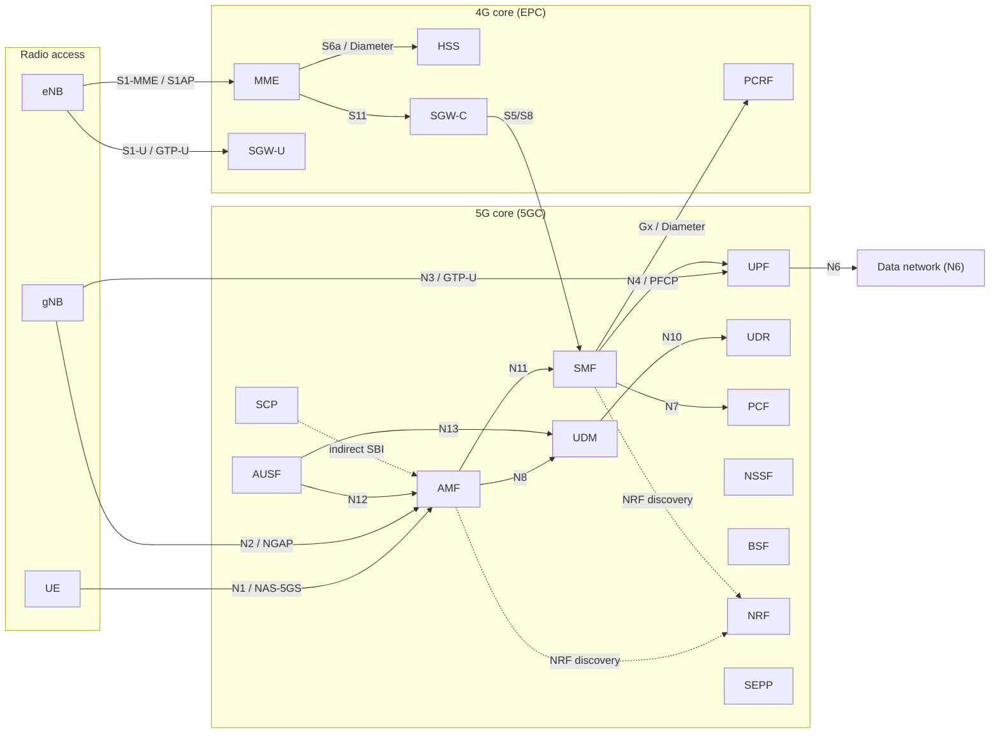

<div align="center">

# Aether5GC

**Open-source 5G Core and EPC for LTE and NR networks.**

Aether5GC is a production-grade, C-language implementation of the 5G System (5GS)
and the Evolved Packet Core (EPC). It provides the complete mobile packet core —
from the radio-facing control plane to the user-plane gateway — in a single,
self-contained codebase that runs on standard Linux hosts.

[](LICENSE)
[](#project-status)
[](#repository-layout)
[](#build-matrix)

[Overview](#overview) · [Architecture](#architecture) · [Quick start](#quick-start) ·
[Configuration](#configuration) · [Testing](#testing) · [Documentation](#documentation)

</div>

> **Project lineage**
>
> Aether5GC is a rebranded distribution of [Open5GS](https://github.com/open5gs/open5gs)
> 2.8.0. Upstream copyright notices, license headers, and third-party
> attributions are preserved. See [NOTICE](NOTICE) and
> [License & attribution](#license--attribution). Aether5GC is **not**
> affiliated with or endorsed by the Open5GS project or NewPlane.

## Project status

Aether5GC tracks Open5GS 2.8.0. It is a rebranded distribution, not a
from-scratch reimplementation; upstream remains the source of truth for
protocol work and security fixes. The codebase is stable for labs, testbeds,
and production-adjacent deployments, but it is not a substitute for a
vendor-supported core in regulated carrier networks.

---

## Table of contents

- [Overview](#overview)
- [Project status](#project-status)
- [Architecture](#architecture)
- [Repository layout](#repository-layout)
- [Quick start](#quick-start)
- [Configuration](#configuration)
- [Running the core](#running-the-core)
- [Testing](#testing)
- [Observability](#observability)
- [Web UI](#web-ui)
- [Build matrix](#build-matrix)
- [Troubleshooting](#troubleshooting)
- [Documentation](#documentation)
- [Contributing](#contributing)
- [Security](#security)
- [License & attribution](#license--attribution)

---

## Overview

A mobile network is split into a **radio access network (RAN)** and a **core
network**. The RAN (eNodeB / gNodeB) terminates the radio link; the core
authenticates subscribers, tracks their mobility, establishes data sessions,
applies policy, and forwards user traffic to external data networks.

Aether5GC implements that core. It speaks the standard 3GPP interfaces, so it
works with commercial and open-source RANs (srsRAN, OpenAirInterface, UERANSIM,
and real gNBs) without proprietary extensions.

### Who it is for

- **Researchers and students** building private 5G/LTE testbeds.
- **Operators and integrators** prototyping standalone (SA) 5G and EPC deployments.
- **RAN and UE vendors** who need a reference core for interoperability testing.
- **Developers** who want a readable, event-driven C implementation of the
  mobile core to learn from or extend.

### What you get

| Plane | 5G System (5GC) | Evolved Packet Core (EPC) |
| --- | --- | --- |
| Control | AMF, SMF, AUSF, UDM, UDR, PCF, NRF, NSSF, BSF, SCP, SEPP, 5G-EIR | MME, HSS, SGW-C, PCRF |
| User | UPF | SGW-U |

SMF and UPF also act as the PGW-C and PGW-U for EPC deployments, so a single
SMF/UPF pair can serve both 4G and 5G sessions.

### Supported features

- Release-19 compliant core network functions.
- 5G standalone (SA) registration, PDU session establishment, and mobility.
- Multiple concurrent PDU sessions and IPv4/IPv6 dual-stack.
- Handover: 5GC Xn/N2 and EPC S1/X2.
- CSFB (Circuit Switched Fallback) and SMS over SGs.
- VoLTE (with HSS-Cx) and VoNR.
- ePDG support (SWx, S6b, S2b).
- 5G roaming via SEPP (N32) and the service communication proxy (SCP).
- Network slicing (NSSF), policy control (PCF), and binding support (BSF).
- 5G-EIR equipment identity checks.
- Authentication with Milenage, AES, Snow3G, and ZUC.
- Prometheus metrics and a JSON info API for UEs and gNBs.

### Known limitations

- No EPC ↔ 5GC interworking (N26).
- No NB-IoT.
- No OCS/OFCS (online/offline charging).
- No eMBMS.
- No SRVCC.
- No emergency call support.

---

## Architecture

Aether5GC is a set of **independent network functions (NFs)** that communicate
over 3GPP-defined interfaces. Control-plane NFs use the **Service-Based
Architecture (SBA)** — JSON over HTTP/2 — while the user plane uses GTP-U and
PFCP.



### Runtime model

Every NF is a separate daemon built from the same shared core. Each one follows
an identical structure:

```
app.c            process entry point (app_initialize / app_terminate)
init.c           configuration, thread startup, event loop, FSM dispatch
context.c/.h     global NF state, hash tables, configuration
event.c/.h       typed event definitions
<name>-sm.c      protocol state machine
n<if>-build.c    request construction for an SBI interface
n<if>-handler.c  response handling for an SBI interface
<proto>-path.c   protocol transport (NGAP, PFCP, GTP, Diameter, …)
timer.c          NF-specific timers
metrics.c        Prometheus collectors
```

The event loop is a single-threaded **pollset + timer manager + event queue**
design (`ogs_pollset_poll`, `ogs_timer_mgr_expire`, `ogs_queue_trypop`), with
`talloc` for memory ownership. This keeps state machines deterministic and makes
the code straightforward to debug.

For a code-level walkthrough — the FSM framework, the 5G registration trace,
SBI/NRF discovery, and the PFCP/GTP-U user plane — see
**[ARCHITECTURE.md](ARCHITECTURE.md)**.

### Interfaces

| Interface | Protocol | Between |
| --- | --- | --- |
| N1 | NAS-5GS | UE ↔ AMF |
| N2 | NGAP over SCTP | gNB ↔ AMF |
| N3 | GTP-U | gNB ↔ UPF |
| N4 | PFCP | SMF ↔ UPF |
| N6 | IP | UPF ↔ data network |
| N7, N8, N10, N11, N12, N13, N15, N22 | HTTP/2 SBI | 5G control-plane NFs |
| N32 | SBI over TLS | SEPP ↔ SEPP (roaming) |
| S1-MME | S1AP over SCTP | eNB ↔ MME |
| S1-U | GTP-U | eNB ↔ SGW-U |
| S11 | GTPv2-C | MME ↔ SGW-C |
| S5/S8 | GTPv2-C / GTP-U | SGW ↔ PGW (SMF/UPF) |
| S6a | Diameter | MME ↔ HSS |
| Gx / Gy | Diameter | SMF ↔ PCRF |
| SGs | SCTP | MME ↔ MSC |
| SWx / S6b / S2b | Diameter / GTP | ePDG ↔ core |

---

## Repository layout

```
src/                 Network functions (one executable per NF)
  amf/ smf/ upf/    5G core control and user plane
  ausf/ udm/ udr/ pcf/ nrf/ nssf/ bsf/ scp/ sepp/ eir/
  mme/ hss/ sgwc/ sgwu/ pcrf/   4G / EPC nodes
  main.c            shared CLI entry point
lib/                 Reusable libraries
  core/             event loop, FSM, timers, sockets, TLV, hash, logging
  app/              YAML configuration and application context
  sbi/              HTTP/2 SBI clients, servers, and NRF discovery
  nas/ ngap/ s1ap/  NAS and RAN signaling codecs (ASN.1 via asn1c)
  gtp/ pfcp/        GTP and PFCP protocols
  diameter/ sctp/   Diameter stack and SCTP transport
  dbi/              MongoDB access for subscriber and session data
  crypt/            Milenage, AES, Snow3G, ZUC
  ipfw/ tun/        IP forwarding rules and TUN devices
  metrics/          Prometheus metrics endpoint
configs/             YAML templates and deployment examples
tests/               Unit and end-to-end protocol tests
docs/                Jekyll documentation site
webui/               Subscriber management UI (Node.js + MongoDB)
docker/ debian/      Container and package builds
misc/                Helper scripts (network setup, certificates, …)
subprojects/         Meson wraps
```

---

## Quick start

Pick the path that matches your goal. **Docker** is the fastest way to see a
working core; a **native Linux build** is what you want for development and
production.

### Option A — Docker (fastest)

Requires Docker with Linux containers.

```bash
cd docker
docker compose run test     # builds the image and runs the full test suite
```

For an interactive development shell with the project already built:

```bash
docker compose run dev
# inside the container:
cd /open5gs/build
sudo meson test -v
./tests/registration/registration
```

The compose file provides `NET_ADMIN`, `/dev/net/tun`, and a MongoDB instance,
so no host network changes are required.

### Option B — Linux (recommended)

Debian/Ubuntu example:

```bash
sudo apt update
sudo apt install -y python3-pip python3-setuptools python3-wheel ninja-build \
    build-essential flex bison git cmake meson pkg-config \
    libsctp-dev libc-ares-dev libgnutls28-dev libgcrypt-dev libssl-dev \
    libmongoc-dev libbson-dev libyaml-dev libnghttp2-dev libmicrohttpd-dev \
    libcurl4-gnutls-dev libtins-dev libtalloc-dev libidn-dev

# Build
meson setup build --prefix="$PWD/install"
ninja -C build

# Network prerequisites (TUN devices, IP forwarding)
sudo ./misc/netconf.sh

# Install binaries, configs, and systemd units
sudo ninja -C build install

# Start MongoDB, then the core
sudo systemctl enable --now mongod
sudo systemctl enable --now open5gs-nrfd open5gs-amfd open5gs-smfd \
    open5gs-upfd open5gs-ausfd open5gs-udmd open5gs-udrd open5gs-pcfd \
    open5gs-nssfd open5gs-bsfd
```

### Option C — macOS (development)

Requires Homebrew and Xcode command-line tools. macOS uses the built-in `utun`
driver, so no external TUN/TAP driver is needed.

```bash
brew install meson ninja cmake pkg-config bison \
    mongo-c-driver gnutls libgcrypt libidn c-ares libyaml \
    libmicrohttpd nghttp2 libusrsctp libtins talloc mongodb-community

export PATH="/opt/homebrew/opt/curl/bin:/opt/homebrew/opt/bison/bin:/opt/homebrew/bin:$PATH"
export PKG_CONFIG_PATH="/opt/homebrew/opt/curl/lib/pkgconfig:/opt/homebrew/opt/openssl/lib/pkgconfig:$PKG_CONFIG_PATH"
export LIBRARY_PATH=/opt/homebrew/lib
export C_INCLUDE_PATH=/opt/homebrew/include
export CPLUS_INCLUDE_PATH=/opt/homebrew/include

brew services start mongodb-community

meson setup build --prefix="$PWD/install"
ninja -C build
sudo ./misc/netconf.sh

# End-to-end tests (require sudo for the TUN device)
sudo ./build/tests/registration/registration
sudo ./build/tests/attach/attach
```

See [docs/_docs/platform](docs/_docs/platform) for platform-specific notes.

---

## Configuration

Each NF is configured by a YAML file. Templates live in
[`configs/open5gs/`](configs/open5gs) and are installed to
`$prefix/etc/open5gs/<nf>.yaml`.

A typical configuration covers:

- **Logger** — file path and level (`fatal|error|warn|info|debug|trace`).
- **Global limits** — maximum number of UEs and peers.
- **SBI** — server bind address/port, NRF/SCP clients, delegation, and TLS.
- **Protocol listeners** — NGAP/SCTP, GTP-U, PFCP, Diameter.
- **Network identity** — PLMN, GUAMI, TAI, slices (S-NSSAI), and security algorithms.
- **Timers** — 5GMM and session-management timers.

Run a single NF in the foreground with an explicit config:

```bash
sudo ./install/bin/open5gs-amfd -c install/etc/open5gs/amf.yaml -d
```

Select a named configuration section with `-k <id>` when running multiple
instances from one file. Use `-h` for the full CLI reference.

> **Naming note.** Executables, systemd units, and configuration paths retain
> the upstream `open5gs-*` names. This keeps packaging, scripts, and existing
> deployments compatible after the rebrand.

---

## Running the core

There are two ways to run the project:

1. **End-to-end tests** — start the real NFs plus a simulated gNB/eNB and UE.
   This is the quickest way to verify a build and the best smoke test.
2. **Production daemons** — install the configs and start each NF as a service.

For the 5G core, start the NRF first (or the SCP if you use indirect
communication), then the remaining NFs. For a minimal 5G SA setup:

```bash
sudo systemctl start open5gs-nrfd
sudo systemctl start open5gs-amfd open5gs-smfd open5gs-upfd
sudo systemctl start open5gs-ausfd open5gs-udmd open5gs-udrd open5gs-pcfd
```

Logs are written to `$prefix/var/log/open5gs/<nf>.log`; the log level can be
changed at runtime with `SIGHUP`.

---

## Testing

The test suite uses the `abts` harness and includes unit tests plus full
protocol emulation.

```bash
cd build
sudo meson test -v
```

Individual suites:

```bash
sudo ./build/tests/registration/registration   # 5G registration
sudo ./build/tests/attach/attach               # 4G attach
sudo ./build/tests/handover/handover           # mobility
sudo ./build/tests/volte/volte                 # VoLTE
sudo ./build/tests/vonr/vonr                   # VoNR
sudo ./build/tests/csfb/csfb                   # CSFB
sudo ./build/tests/310014/310014               # conformance scenario
```

`sudo` is required because the tests create TUN devices and bind privileged
ports.

---

## Observability

Every NF can expose a Prometheus endpoint (default `127.0.0.x:9090`):

```bash
curl http://127.0.0.5:9090/metrics
```

The AMF additionally exposes JSON info endpoints for live topology:

```bash
curl http://127.0.0.5:9090/gnb-info
curl http://127.0.0.5:9090/ue-info
```

See [`docs/_docs/tutorial/04-metrics-prometheus.md`](docs/_docs/tutorial/04-metrics-prometheus.md)
and [`docs/_docs/tutorial/07-infoAPI-UE-gNB-session-data.md`](docs/_docs/tutorial/07-infoAPI-UE-gNB-session-data.md).

---

## Web UI

The optional Web UI manages subscribers and sessions in MongoDB.

```bash
cd webui
npm ci
npm run dev        # http://localhost:9999
```

MongoDB must be running and reachable at the URI configured in the UI (default
`mongodb://localhost/open5gs`).

---

## Build matrix

| Platform | Status | Notes |
| --- | --- | --- |
| Linux (Debian/Ubuntu, Fedora, CentOS, Alpine) | Primary | Full feature set; systemd units included |
| macOS (Apple Silicon / Intel) | Development | Uses `utun`; no systemd; tests require `sudo` |
| FreeBSD | Community | See the platform notes in `docs/` |

**Requirements:** a C89 (`gnu89`) compiler, Meson ≥ 0.43, Ninja, pkg-config,
and the libraries listed in the quick-start section. MongoDB is required by
HSS, PCRF, UDR, and PCF.

The build is intentionally strict (`-Werror` on pointer arithmetic,
initialization, return types, format strings, and more). Warnings are treated
as defects, not suggestions.

---

## Troubleshooting

| Symptom | Likely cause | Fix |
| --- | --- | --- |
| `Failed to connect to MongoDB` | `mongod` not running | Start MongoDB and check `db_uri` |
| `ogstun` not found | TUN device missing | Run `sudo ./misc/netconf.sh` |
| `bind: Address already in use` | Another NF or process owns the port | Check `ss -lntup`; each NF uses its own `127.0.0.x` address |
| SCTP association fails | Firewall or missing `libsctp` | Allow SCTP; verify NGAP port 38412 |
| `Permission denied` on `/dev/net/tun` | Missing capability | Run with `sudo` or add `NET_ADMIN` |
| Tests pass but no traffic | No RAN/UE attached | Use the test suite or connect a real gNB/eNB |

For more, see [`docs/_docs/troubleshoot/`](docs/_docs/troubleshoot).

---

## Documentation

- **Architecture & reverse-engineering walkthrough:** [`ARCHITECTURE.md`](ARCHITECTURE.md)
- **Upstream documentation:** <https://open5gs.org/open5gs/docs/>
- **Local docs site:** [`docs/`](docs) (Jekyll; `bundle exec jekyll serve`)
- **Build guide:** [`docs/_docs/guide/02-building-open5gs-from-sources.md`](docs/_docs/guide/02-building-open5gs-from-sources.md)
- **Platform notes:** [`docs/_docs/platform/`](docs/_docs/platform)
- **Tutorials:** [`docs/_docs/tutorial/`](docs/_docs/tutorial)

---

## Contributing

Contributions are welcome. Before opening a pull request:

1. Read the upstream [Contributor License Agreement](https://open5gs.org/open5gs/cla/).
2. Keep changes focused and consistent with the surrounding code style.
3. Build and run the relevant test suite (`sudo meson test -v`).
4. Include a clear description of the problem, the approach, and the validation.

Upstream issue tracker and discussions:

- Issues: <https://github.com/open5gs/open5gs/issues>
- Discussions: <https://github.com/open5gs/open5gs/discussions>

---

## Security

Please do not open public issues for security vulnerabilities. Report them
privately to the upstream maintainers and to the maintainers of this
distribution. See [`.github/SECURITY.md`](.github/SECURITY.md).

---

## License & attribution

Aether5GC is distributed under the **GNU Affero General Public License v3.0 or
later (AGPL-3.0-or-later)**. See [LICENSE](LICENSE).

This project is derived from **Open5GS**:

- Upstream: <https://github.com/open5gs/open5gs>
- Author: Sukchan Lee and Open5GS contributors
- Copyright: © 2019–2025 Sukchan Lee and contributors
- License: AGPL-3.0-or-later
- Distribution maintainer: [Zakariaelqannaa-dv](https://github.com/zakariaelqannaa-dv)

All upstream copyright notices and license headers are retained. The names
"Open5GS", "NewPlane", and associated logos are trademarks of their respective
owners. Aether5GC is an independent distribution and is not endorsed by or
affiliated with the upstream project.

See [NOTICE](NOTICE) for the full attribution statement.

---

<div align="center">

**Aether5GC** — a readable, standards-based mobile core.

</div>
